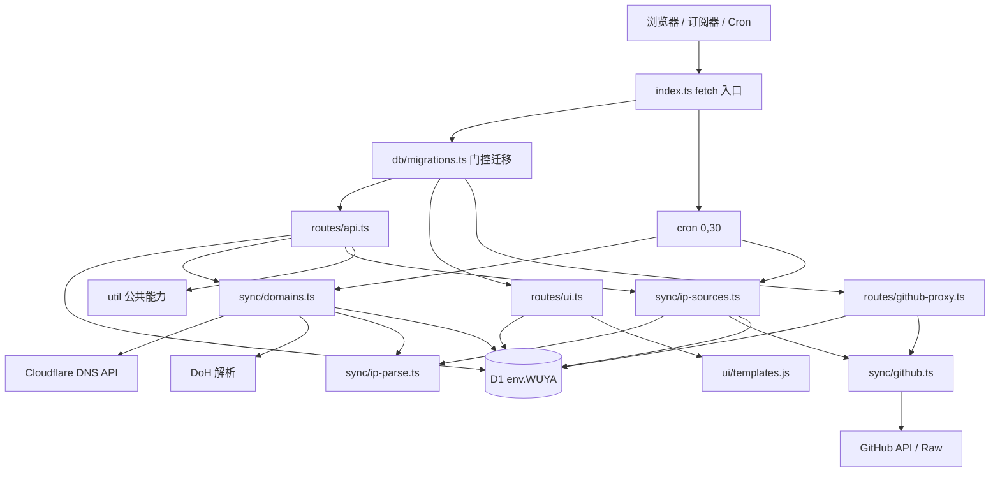
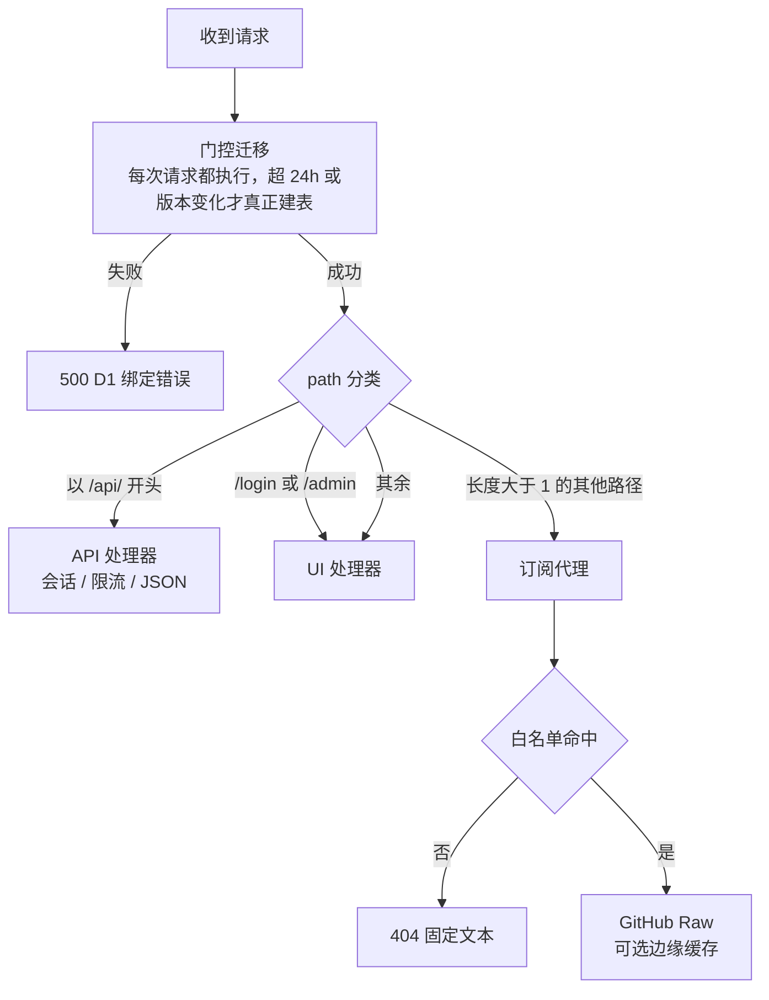
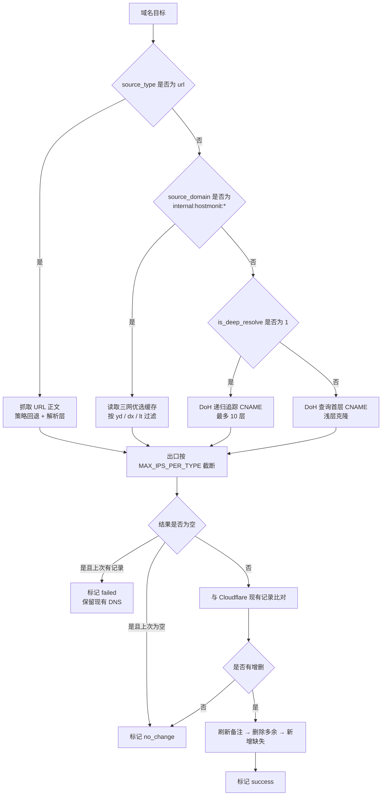
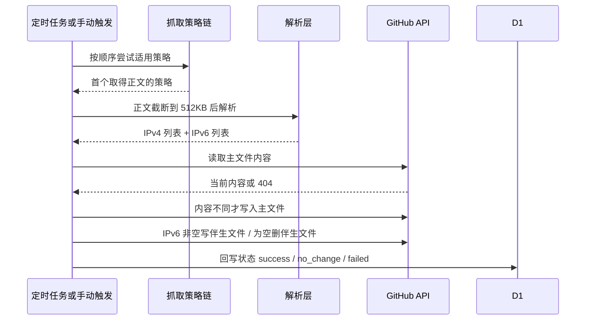
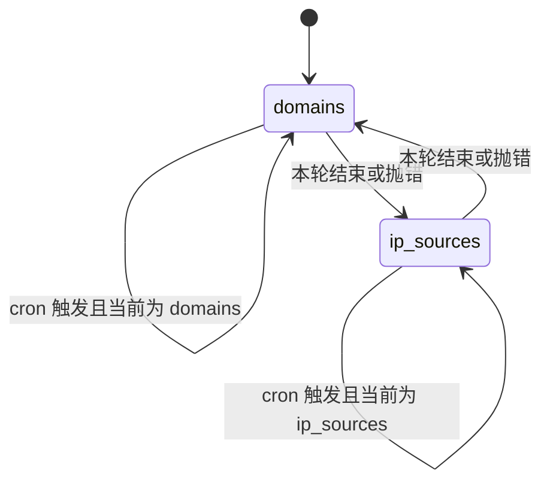
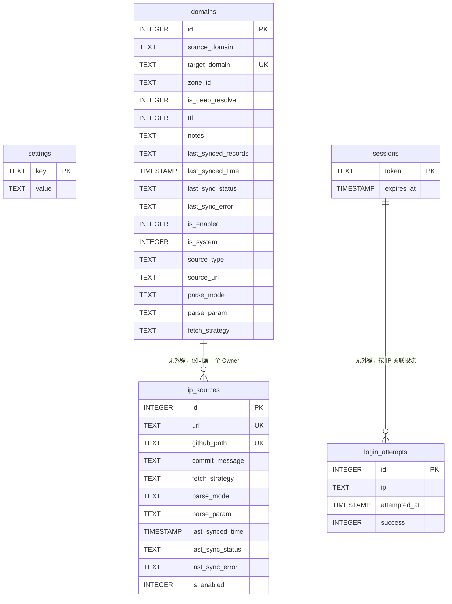
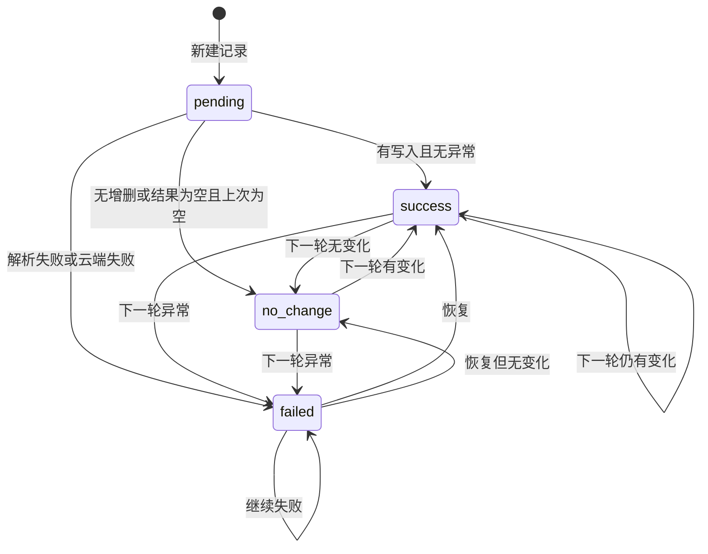

# DNS Clone 系统需求规格说明书（现状基线）

| 项目       | 内容                                                                      |
| ---------- | ------------------------------------------------------------------------- |
| 文档性质   | 现状需求规格（as-is SRS），描述系统当前必须满足的行为，不包含未来演进提案 |
| 事实源     | 仓库源码为唯一事实源；`README.md` 仅作交叉验证，冲突处见附录 A            |
| 基准提交   | `7a36217`（`git rev-parse --short HEAD`）                                 |
| 数据库版本 | `MIGRATION_VERSION = 2026-11-10-ip-fetch-unification`                     |
| 生成日期   | 2026-11-15                                                                |
| 需求总量   | 功能需求 110 条，非功能需求 39 条                                         |

> 本文档的每一条需求都可以在源码中找到对应实现，或在附录 A 中记录为文档与实现的差异。
> 文档不评价实现优劣，附录 B 仅记录可验证的限制事实。

## 0. 文档说明

### 0.1 目的与范围

本文档把 DNS Clone 现有实现反向工程为可复核的需求基线，回答三个问题：

1. 系统对外承诺哪些行为（功能需求与接口契约）。
2. 系统在安全、性能、可靠性上必须守住哪些不变量（非功能需求）。
3. 每条需求由哪段源码实现、由哪个测试覆盖（追溯矩阵）。

范围包含 Cloudflare Worker 的全部运行时代码、D1 表结构、HTTP 接口、页面行为、定时任务与部署脚本；
不包含 Cloudflare 平台自身能力、第三方 IP 源站点的可用性，以及用户本地的 Wrangler 配置。

### 0.2 读者与使用方式

| 读者       | 用法                                                           |
| ---------- | -------------------------------------------------------------- |
| 接手开发者 | 按第 2、3、4 章建立心智模型，按第 7 章定位源码与测试           |
| 变更评审者 | 以需求编号为锚点判断改动是否破坏既有契约，重点看标注 P0 的条目 |
| 部署运维者 | 阅读第 6 章与第 5.4 节，确认前置资源、权限与升级影响           |

### 0.3 事实源与冲突处理

- 需求描述与源码不一致时，以源码为准。
- `README.md` 中与源码不符的表述不在正文中沿用，统一登记在附录 A。
- 无法从源码确认的推测不写入正文；确有必要时标注「待确认」并列入附录 B。

### 0.4 需求编号与优先级

| 前缀       | 含义                                 | 条目数 |
| ---------- | ------------------------------------ | ------ |
| `REQ-AUTH` | 初始化与会话认证                     | 10     |
| `REQ-SET`  | 系统设置                             | 11     |
| `REQ-DOM`  | 域名目标管理                         | 14     |
| `REQ-SYN`  | 域名同步                             | 19     |
| `REQ-IPS`  | IP 源管理与探测                      | 13     |
| `REQ-GHP`  | IP 源同步与 GitHub 发布              | 14     |
| `REQ-PRX`  | 订阅代理                             | 6      |
| `REQ-UI`   | 页面与交互                           | 7      |
| `REQ-SCH`  | 定时调度与轮转                       | 6      |
| `REQ-DBM`  | 数据迁移与初始数据                   | 10     |
| `NFR-*`    | 安全、性能、可靠性、运维、兼容、质量 | 39     |

优先级定义：

- **P0**：安全边界、数据正确性、核心链路可用性。破坏即视为严重缺陷。
- **P1**：主要功能行为。破坏会导致功能不可用或结果错误。
- **P2**：体验、可运维性、便利性。破坏不阻断主流程。

### 0.5 术语

| 术语                         | 含义                                                             |
| ---------------------------- | ---------------------------------------------------------------- |
| 域名目标（domain target）    | 一条待克隆记录，`target_domain` 为最终写入 Cloudflare 的完整域名 |
| 系统域名（system domain）    | `is_system = 1` 的内置目标，来源固定，不可删除                   |
| URL 型目标                   | `source_type = url`，从任意网页按解析模式提取 IP                 |
| 深度解析（deep resolve）     | 递归追踪 CNAME 链，直到拿到 A/AAAA 记录                          |
| 浅层克隆（shallow clone）    | 只复制第一层 CNAME，不追踪链尾                                   |
| IP 源（IP source）           | 从网页抓取 IP 并发布到 GitHub 仓库文件的配置单元                 |
| 伴生文件（companion file）   | 主文件对应的 IPv6 文件，路径由主文件派生                         |
| 订阅代理（subscriber proxy） | 把 GitHub 文件以稳定路径暴露给订阅器的只读入口                   |
| 抓取策略（fetch strategy）   | 依次尝试的取数通道，如直连、镜像、阅读器                         |
| 解析模式（parse mode）       | `auto`、`lines`、`json_path`、`custom_regex` 四种正文提取方式    |
| 轮转（rotation）             | 定时任务在域名同步与 IP 源同步之间交替执行                       |
| 批次（batch）                | 单轮定时任务处理的记录上限，由 `BATCH_SIZE` 控制                 |

## 1. 系统概述

### 1.1 产品定位

DNS Clone 是一个部署在 Cloudflare Worker 上的双能力工具：

1. **域名克隆**：把源域名解析出的 IP 写入用户自己的 Cloudflare DNS 记录，形成持续同步的镜像。
2. **IP 聚合**：从多个网页源抓取 IP，发布到 GitHub 仓库文件，再经订阅代理暴露为稳定订阅地址。

两条能力共享同一套 D1 数据库、同一套设置与同一条定时调度链。

### 1.2 角色与使用场景

| 角色     | 典型场景                                           | 权限边界                       |
| -------- | -------------------------------------------------- | ------------------------------ |
| 访客     | 打开首页查看已启用的域名与 IP 源状态               | 只能读取公开列表，不能触发同步 |
| 管理员   | 初始化系统、配置凭据、增删目标、手动同步、查看日志 | 持有会话后可调用全部写接口     |
| 订阅器   | 定期拉取 GitHub 上的 IP 文件                       | 只能读取白名单内的代理路径     |
| 定时任务 | 每 30 分钟按批次同步域名或 IP 源                   | 无会话，直接调用同步逻辑       |

### 1.3 运行边界与约束

| 约束       | 事实                                                                 | 影响                                    |
| ---------- | -------------------------------------------------------------------- | --------------------------------------- |
| 运行平台   | Cloudflare Worker，ESM，`compatibility_date` 由 `wrangler.toml` 固定 | 无 Node 原生依赖，受 CPU 与出站连接限制 |
| 数据库     | 唯一 D1 绑定 `env.WUYA`                                              | 不允许出现第二个绑定名                  |
| 定时任务   | cron `0,30 * * * *`                                                  | 每小时两轮，单轮受批次上限约束          |
| 运行时依赖 | `package.json` 中无生产依赖                                          | 所有能力用平台 API 与手写实现           |
| 迁移策略   | 幂等 DDL + 24 小时门控                                               | 回滚只需回退代码，不需逆向 DDL          |
| 部署形态   | 网页粘贴单文件或 CLI 部署                                            | `database_id` 在提交态保持占位符        |

### 1.4 模块地图



模块职责：

| 目录           | 职责                                      | 不负责              |
| -------------- | ----------------------------------------- | ------------------- |
| `src/index.ts` | 路由分流、全局异常兜底、cron 入口         | 业务规则            |
| `src/routes/`  | HTTP 契约、参数校验、状态码、SSE 包装     | 解析与写入细节      |
| `src/sync/`    | 同步编排、抓取、解析、DNS 与 GitHub 写入  | HTTP 会话与页面渲染 |
| `src/db/`      | 连接、迁移、设置读写、初始数据            | 业务判断            |
| `src/ui/`      | HTML 模板与浏览器端脚本                   | 服务端数据校验      |
| `src/util/`    | 认证、SSRF、fetch、批处理、日志等横切能力 | 领域流程            |

### 1.5 请求路由



路由判定优先级由源码顺序决定：先迁移，再按 `/api/`、`/login` 与 `/admin`、长度大于 1 的其他路径、其余路径依次分流。
订阅代理未命中时直接返回 404，不回落 UI。

### 1.6 端到端数据流

域名链路：

```text
源域名 / URL → 解析（URL 抓取或 DoH CNAME 追踪）→ IP 列表 → 单类型截断
→ 与 Cloudflare 现有记录比对 → 增删记录 → 回写同步状态
```

IP 源链路：

```text
源 URL → 抓取策略回退 → 正文解析（四模式）→ IPv4 主文件 + IPv6 伴生文件
→ GitHub 内容比对 → 写文件或删伴生 → 回写同步状态 → 订阅代理暴露
```

## 2. 功能需求

### 2.1 初始化与会话认证（REQ-AUTH）

| 编号        | 优先级 | 需求                                                              | 验收标准                                                                                                                        |
| ----------- | ------ | ----------------------------------------------------------------- | ------------------------------------------------------------------------------------------------------------------------------- |
| REQ-AUTH-01 | P0     | 系统未初始化时，首次访问只能进入初始化页                          | 未写入管理员哈希时，访问 `/`、`/admin`、任意代理路径均返回初始化页，不泄露域名或 IP 源数据                                      |
| REQ-AUTH-02 | P0     | 初始密码长度必须在 8 到 1024 字符之间                             | 少于 8 或多于 1024 返回 400，且不写入任何设置                                                                                   |
| REQ-AUTH-03 | P0     | 密码使用 PBKDF2-SHA256 派生，迭代 100000 次，随机盐以十六进制存储 | 数据库中密码字段形如 `pbkdf2$100000$<salt>$<hex>`，盐每次初始化不同                                                             |
| REQ-AUTH-04 | P0     | 初始化必须是原子且幂等的                                          | 并发两次初始化只有一次成功；已初始化时再次调用返回 403                                                                          |
| REQ-AUTH-05 | P0     | 登录失败按来源 IP 限流：5 分钟窗口内失败 5 次即拒绝               | 第 6 次尝试返回 429；窗口内成功登录后失败计数清零                                                                               |
| REQ-AUTH-06 | P1     | 登录成功签发 24 小时会话                                          | 服务端生成 UUID 令牌写入 `sessions`；响应设置 `session` Cookie，属性为 HttpOnly、Secure、Path=/、SameSite=Strict、Max-Age=86400 |
| REQ-AUTH-07 | P1     | 会话过期或不存在视为未登录                                        | 过期会话被删除；访问 `/admin` 返回 302 到 `/`                                                                                   |
| REQ-AUTH-08 | P1     | 旧格式密码在登录成功后自动升级                                    | 旧的「盐 + 哈希」与裸十六进制格式均可在正确密码下升级为 PBKDF2 格式                                                             |
| REQ-AUTH-09 | P1     | 登出必须同时删除服务端会话与 Cookie                               | 登出后同一 Cookie 再访问受保护接口返回未授权                                                                                    |
| REQ-AUTH-10 | P0     | 密码比对必须恒定时间                                              | 使用固定长度十六进制比较函数，不使用普通字符串相等                                                                              |

**核心路径验收：初始化**

1. 前置：数据库为空，无管理员哈希。
2. 行为：提交长度合规的密码。
3. 期望：返回成功，写入哈希与盐，写入迁移标记；`/admin` 可进入登录后页面。

**核心路径验收：登录限流**

1. 前置：系统已初始化，同一 IP 在 5 分钟内失败 5 次。
2. 行为：第 6 次提交错误密码。
3. 期望：返回 429，且不再执行密码比对。

### 2.2 系统设置（REQ-SET）

可写键共 9 个，其余键一律忽略：

| 键                     | 类别 | 校验               | 说明                       |
| ---------------------- | ---- | ------------------ | -------------------------- |
| `CF_API_TOKEN`         | 密钥 | 非空               | Cloudflare API Token       |
| `CF_ZONE_ID`           | 配置 | 非空               | 目标 Zone                  |
| `GITHUB_TOKEN`         | 密钥 | 非空               | 仓库读写 Token             |
| `GITHUB_OWNER`         | 配置 | 非空               | 仓库所有者                 |
| `GITHUB_REPO`          | 配置 | 非空               | 仓库名                     |
| `HOSTMONIT_API_KEY`    | 密钥 | 非空               | 三网数据源密钥             |
| `THREE_NETWORK_SOURCE` | 配置 | 必须指向 HostMonit | 与内置域名匹配的数据源地址 |
| `BATCH_SIZE`           | 配置 | 整数 1–100         | 单轮批次上限               |
| `MAX_IPS_PER_TYPE`     | 配置 | 整数 1–200         | 单类型 IP 上限             |

| 编号       | 优先级 | 需求                                               | 验收标准                                                    |
| ---------- | ------ | -------------------------------------------------- | ----------------------------------------------------------- |
| REQ-SET-01 | P0     | 写入必须命中白名单                                 | 提交未知键不报错也不落库                                    |
| REQ-SET-02 | P0     | `null` 表示显式清除                                | 密钥键传 `null` 后，库中键被删除，配置状态变为未配置        |
| REQ-SET-03 | P0     | 密钥键传空字符串表示保持原值                       | 已配置的 Token 不因空串被清空                               |
| REQ-SET-04 | P1     | 非密钥键传空字符串表示清除                         | 清空后回落到默认值                                          |
| REQ-SET-05 | P1     | `BATCH_SIZE` 必须为 1–100 的整数                   | 越界或非整数返回 400，原值不变                              |
| REQ-SET-06 | P1     | `MAX_IPS_PER_TYPE` 必须为 1–200 的整数             | 越界或非整数返回 400；显式清除后恢复默认 20                 |
| REQ-SET-07 | P0     | Cloudflare 两项凭据必须成对出现                    | 只配 Token 或只配 Zone 时返回 400                           |
| REQ-SET-08 | P0     | GitHub 三项凭据必须同时具备                        | 缺任一项时返回 400                                          |
| REQ-SET-09 | P1     | 保存前必须校验 Cloudflare 凭据可用                 | Token 或 Zone 无效时返回 400，且本次不写入任何设置          |
| REQ-SET-10 | P1     | 校验通过后缓存 Zone 名称并按 Zone 幂等播种初始数据 | 同一 Zone 重复保存不重复插入；Zone 变更后重新播种           |
| REQ-SET-11 | P0     | 读取设置时不得回传密钥与内部状态                   | 响应只含派生布尔（是否已配置）、Zone 名称与规范化后的上限值 |

**核心路径验收：保存 Cloudflare 凭据**

1. 前置：系统已初始化，Token 与 Zone 均有效。
2. 行为：提交两项凭据。
3. 期望：调用 Zone 查询成功，缓存 Zone 名称，写入凭据，触发初始数据播种，返回成功。

**核心路径验收：错误凭据**

1. 前置：Token 无效或 Zone 不属于该 Token。
2. 行为：提交两项凭据。
3. 期望：返回 400 并带可读原因；数据库中两项凭据保持原值。

### 2.3 域名目标管理（REQ-DOM）

| 编号       | 优先级 | 需求                                      | 验收标准                                                                                        |
| ---------- | ------ | ----------------------------------------- | ----------------------------------------------------------------------------------------------- |
| REQ-DOM-01 | P1     | 列表按系统域名优先、再按目标域名排序      | `is_system = 1` 的记录排在前面，其余按字典序                                                    |
| REQ-DOM-02 | P1     | 支持两种输入类型：域名与 URL              | `source_type` 仅接受 `domain` 与 `url`，其他值返回 400                                          |
| REQ-DOM-03 | P1     | 域名型必须满足主机名规则或内置三网形式    | 长度不超过 253；`internal:hostmonit:<yd                                                         |
| REQ-DOM-04 | P1     | URL 型必须通过 URL 与 SSRF 校验           | 仅允许 http/https，长度不超过 2048；内网、回环、链路本地、云元数据地址返回 400                  |
| REQ-DOM-05 | P1     | URL 型从 URL 派生源域名并强制关闭深度解析 | 保存后 `source_domain` 等于 URL 主机名，`is_deep_resolve = 0`                                   |
| REQ-DOM-06 | P2     | URL 变更时清空缓存抓取策略                | URL 变化后 `fetch_strategy` 置空，下一轮重新探测                                                |
| REQ-DOM-07 | P1     | 子域名前缀必须符合 DNS 标签规则           | 默认 `@`；其余必须匹配小写字母、数字、连字符且不以连字符开头结尾，否则 400                      |
| REQ-DOM-08 | P1     | TTL 必须是 1 或 60–86400                  | 其他值返回 400；默认 60                                                                         |
| REQ-DOM-09 | P1     | 深度解析开关接受 0、1 与布尔值            | 其他值返回 400；新建默认 1                                                                      |
| REQ-DOM-10 | P1     | 目标域名由前缀与 Zone 名称拼装            | 前缀为 `@` 时等于 Zone 名称，否则为 `前缀.Zone`                                                 |
| REQ-DOM-11 | P0     | 系统域名来源与类型不可修改，且不可删除    | 修改来源或类型返回 403；删除返回 403                                                            |
| REQ-DOM-12 | P1     | 目标域名唯一                              | 重复创建返回 409 并提示「目标域名已存在」                                                       |
| REQ-DOM-13 | P1     | 记录查询支持单个与批量                    | 单个查询对不存在返回 404，Cloudflare 失败返回 500；批量查询按域名分组，单域名失败不影响其他域名 |
| REQ-DOM-14 | P2     | 备注仅用于展示                            | 备注变化不触发 DNS 写入，也不参与同步比对                                                       |

**核心路径验收：新增域名目标**

1. 前置：Cloudflare 凭据已配置且校验通过，前缀合法，目标不重复。
2. 行为：提交域名型目标。
3. 期望：写入一行 `is_enabled = 1`、`last_sync_status = 'pending'` 的记录，返回成功。

**核心路径验收：重复目标**

1. 前置：目标域名已存在。
2. 行为：再次提交相同前缀。
3. 期望：返回 409，数据库行数不变。

### 2.4 域名同步（REQ-SYN）

四分支分流顺序由源码固定，先命中先返回：



| 编号       | 优先级 | 需求                                             | 验收标准                                                                            |
| ---------- | ------ | ------------------------------------------------ | ----------------------------------------------------------------------------------- |
| REQ-SYN-01 | P1     | 四分支按 URL、三网、深度解析、浅层克隆的顺序判定 | 同时满足多个条件时，只走最先命中的分支                                              |
| REQ-SYN-02 | P1     | URL 型目标复用 IP 源的抓取策略链与统一解析层     | 抓取正文后按 `parse_mode`、`parse_param` 解析；实际生效策略写回 `fetch_strategy`    |
| REQ-SYN-03 | P1     | 同一批次内 URL 配置相同只抓取一次                | 缓存键为 URL、归一后的解析模式、解析参数三者组合；失败结果不进入缓存                |
| REQ-SYN-04 | P1     | 三网型按 `yd`、`dx`、`lt` 读取对应线路           | 数据源名取自 `THREE_NETWORK_SOURCE`，默认 `CloudFlareYes`                           |
| REQ-SYN-05 | P1     | 三网数据按批次缓存，失败时保留上次成功缓存       | 同批后续域名继续可用；从未成功过则标记 failed                                       |
| REQ-SYN-06 | P0     | 三网或深度解析结果必须经同一 IP 内核处理         | 校验、去重、排序后再截断；非法 IP 与 IPv4-mapped 地址被剔除                         |
| REQ-SYN-07 | P1     | 深度解析最多追踪 10 层 CNAME                     | 超过 10 层判定为疑似循环，返回空结果                                                |
| REQ-SYN-08 | P1     | CNAME 链尾无 IP 时克隆最后一级 CNAME             | 返回单条 CNAME 记录，不报错                                                         |
| REQ-SYN-09 | P0     | 浅层克隆要求源域名本身是 CNAME                   | 无 CNAME 记录时抛出可读错误并标记 failed                                            |
| REQ-SYN-10 | P0     | 解析结果为空时保护现有 DNS                       | 上次记录非空则本次标记 failed，不发起任何删除                                       |
| REQ-SYN-11 | P1     | 解析结果为空且上次也为空时视为无变化             | 标记 `no_change`，不调用 Cloudflare 写接口                                          |
| REQ-SYN-12 | P1     | 出口统一截断，A 与 AAAA 各自计数                 | CNAME 不参与截断；上限取 `MAX_IPS_PER_TYPE`                                         |
| REQ-SYN-13 | P1     | 变更检测按类型与内容比对                         | 无新增且无删除时标记 `no_change`，不写 DNS                                          |
| REQ-SYN-14 | P1     | 仅在发生增删时刷新 A/AAAA 备注                   | 备注为 `DNS Clone 变更于 YYYY-MM-DD HH:mm`，北京时间精确到分钟；CNAME 无备注        |
| REQ-SYN-15 | P1     | 写入顺序为刷新备注、删除多余、新增缺失           | 每类操作分块并发，单块 10 条；失败即短路并聚合报错                                  |
| REQ-SYN-16 | P0     | Cloudflare 写入失败时保留现有 DNS                | 标记 failed 并记录错误，`last_synced_records` 不被覆盖                              |
| REQ-SYN-17 | P0     | 手动全量同步互斥                                 | 锁被占用时返回 409；锁有效期 10 分钟，每 60 秒最多续租一次，任务结束在 finally 释放 |
| REQ-SYN-18 | P1     | 单域名同步不参与全量锁                           | 可与全量任务并行；禁用域名只记日志并返回                                            |
| REQ-SYN-19 | P0     | 批量同步单条失败不得中断整批                     | 顺序执行，逐条 try/catch，失败只记录日志                                            |

**核心路径验收：URL 型目标正常同步**

1. 前置：目标 `source_type = url`，URL 可访问，解析到 3 个 IPv4。
2. 行为：触发单域名同步。
3. 期望：A 记录被创建，状态为 `success`，`last_synced_records` 保存本次记录集合，`fetch_strategy` 为实际命中策略。

**核心路径验收：空结果保护**

1. 前置：目标上次同步有 2 条 A 记录，本次解析结果为 0。
2. 行为：触发同步。
3. 期望：状态变为 `failed`，Cloudflare 中 2 条记录保持不变，`last_synced_records` 保持不变。

**核心路径验收：并发全量同步**

1. 前置：一个全量同步正在执行且锁未过期。
2. 行为：再次调用全量同步接口。
3. 期望：返回 409，不启动第二个任务；首个任务结束后锁被释放。

### 2.5 IP 源管理与探测（REQ-IPS）

| 编号       | 优先级 | 需求                            | 验收标准                                                                                        |
| ---------- | ------ | ------------------------------- | ----------------------------------------------------------------------------------------------- |
| REQ-IPS-01 | P1     | 列表按 `github_path` 排序       | 排序稳定，与创建顺序无关                                                                        |
| REQ-IPS-02 | P1     | URL 必填且通过 URL 与 SSRF 校验 | 仅 http/https，长度不超过 2048；内网与元数据地址返回 400                                        |
| REQ-IPS-03 | P0     | `github_path` 必须归一化后合法  | 只解码一次；总长 1–512；段长不超过 255；不允许空段、`.`、`..`、反斜杠、残留百分号与前后空白     |
| REQ-IPS-04 | P0     | IPv6 伴生路径必须同样合法       | 由主路径派生的伴生路径也需通过同一校验且总长不超过 512                                          |
| REQ-IPS-05 | P0     | 路径冲突必须双向校验            | 新主路径不得等于任何既有伴生路径；新伴生路径不得等于任何既有主路径；冲突返回 409                |
| REQ-IPS-06 | P1     | 提交信息必填且长度受限          | 去除首尾空白后长度 1–200，否则 400                                                              |
| REQ-IPS-07 | P1     | 解析模式只接受四种取值          | `auto`、`lines`、`json_path`、`custom_regex`；空值归一为 `auto`                                 |
| REQ-IPS-08 | P1     | 解析参数按模式校验              | `json_path` 必填且不超过 512；`custom_regex` 必填且不超过 200，必须可编译并通过危险模式静态检查 |
| REQ-IPS-09 | P0     | 抓取策略不可由客户端写入        | 请求体中的策略字段被忽略；策略只由同步过程或初始数据决定                                        |
| REQ-IPS-10 | P1     | 探测只尝试适用策略              | `hostmonit_api` 仅对 hostmonit.com 生效；探测总预算 25 秒                                       |
| REQ-IPS-11 | P1     | 探测返回策略、数量与样本        | 成功时返回实际策略、IPv4/IPv6 数量与各自最多 5 条样本                                           |
| REQ-IPS-12 | P1     | 探测失败必须可定位              | 全部策略失败返回 400，并带上各策略的失败原因；超时单独说明                                      |
| REQ-IPS-13 | P1     | 增删改的状态码一致              | 重复 URL 或路径返回 409；更新或删除不存在的记录返回 404                                         |

**核心路径验收：伴生路径冲突**

1. 前置：已存在主路径 `a.txt`，即占用伴生路径 `a-v6.txt`。
2. 行为：新增源的主路径填写 `a-v6.txt`。
3. 期望：返回 409；若把新源路径填为 `a`，同样返回 409。

### 2.6 IP 源同步与 GitHub 发布（REQ-GHP）



| 编号       | 优先级 | 需求                                                     | 验收标准                                                                                                             |
| ---------- | ------ | -------------------------------------------------------- | -------------------------------------------------------------------------------------------------------------------- |
| REQ-GHP-01 | P0     | 策略链按配置优先、再按声明顺序尝试，去重且跳过不适用策略 | 已配置策略失败后才回退；同一策略不重复尝试                                                                           |
| REQ-GHP-02 | P1     | 五个策略的超时与请求方式固定                             | 直连 15 秒且带浏览器 UA；PhantomJsCloud 20 秒 POST HTML；CodeTabs 代理 15 秒；Jina Reader 20 秒；HostMonit API 15 秒 |
| REQ-GHP-03 | P1     | HostMonit 密钥可被设置覆盖                               | 未配置时使用内置默认值；密钥轮换无需改代码                                                                           |
| REQ-GHP-04 | P0     | 成功判据必须同时满足正文与至少 1 个 IP                   | 取得正文但 0 条视为「空成功」；全部策略抛错才算失败                                                                  |
| REQ-GHP-05 | P1     | 正文在解析前截断到 512KB                                 | 超长正文不会拖垮解析与 CPU 预算                                                                                      |
| REQ-GHP-06 | P1     | 四种解析模式行为固定                                     | `auto` 同时提取 IPv4 与严格校验的 IPv6；`lines` 逐行取值；`json_path` 按点路径取值；`custom_regex` 取捕获组          |
| REQ-GHP-07 | P0     | IPv6 必须整串结构校验                                    | `::before`、`::2` 等片段不得被识别为地址；不接受带 zone 的地址                                                       |
| REQ-GHP-08 | P1     | 主文件只写 IPv4，一行一个                                | 空结果写空内容，不写占位符                                                                                           |
| REQ-GHP-09 | P1     | IPv6 写入伴生文件                                        | 伴生路径由主路径派生：`x.txt` 变为 `x-v6.txt`，无扩展名时追加 `-v6`                                                  |
| REQ-GHP-10 | P1     | 主文件与伴生文件独立比对                                 | 远程内容去除首尾空白后相同则跳过；两者互不短路                                                                       |
| REQ-GHP-11 | P1     | 伴生文件为空时删除                                       | 仅当远端存在时发起删除；不存在则跳过                                                                                 |
| REQ-GHP-12 | P1     | 状态判定以是否发生写入为准                               | 任一文件落盘为 `success`，全部未变为 `no_change`，抛错为 `failed`                                                    |
| REQ-GHP-13 | P0     | 同步前置条件明确                                         | 缺少 GitHub 配置或源被禁用时不写入，并给出可读错误                                                                   |
| REQ-GHP-14 | P1     | 仓库不存在时自动创建私有仓库                             | 创建失败向上抛错并标记 failed                                                                                        |

**核心路径验收：仅 IPv6**

1. 前置：源只解析出 IPv6，无 IPv4。
2. 行为：触发同步。
3. 期望：主文件写入空内容，伴生文件写入 IPv6，状态为 `success`。

**核心路径验收：IPv6 消失**

1. 前置：远端存在伴生文件，本次解析无 IPv6。
2. 行为：触发同步。
3. 期望：伴生文件被删除；主文件按 IPv4 结果独立处理；状态为 `success`。

### 2.7 订阅代理（REQ-PRX）

| 编号       | 优先级 | 需求                     | 验收标准                                                                       |
| ---------- | ------ | ------------------------ | ------------------------------------------------------------------------------ |
| REQ-PRX-01 | P0     | 只服务白名单路径         | 路径等于某个源的主路径时命中                                                   |
| REQ-PRX-02 | P0     | 伴生路径必须正向推导确认 | 不能仅凭后缀判断；由主路径派生后全等比较才放行                                 |
| REQ-PRX-03 | P1     | 未命中返回 404 固定文本  | 不泄露源列表、仓库名或文件是否存在                                             |
| REQ-PRX-04 | P1     | 未配置 GitHub 时返回 500 | 返回固定配置错误文本，不触发上游请求                                           |
| REQ-PRX-05 | P1     | 成功响应带缓存头         | `text/plain; charset=utf-8`，`Cache-Control: public, max-age=60, s-maxage=300` |
| REQ-PRX-06 | P1     | 上游失败按原状态码透传   | 正文替换为固定文本，避免泄露上游响应细节                                       |

**核心路径验收：白名单正推**

1. 前置：存在源主路径 `a.txt`，不存在 `b-v6.txt` 对应源。
2. 行为：分别请求 `/a-v6.txt` 与 `/b-v6.txt`。
3. 期望：前者命中并返回伴生文件，后者返回 404。

### 2.8 页面与交互（REQ-UI）

| 编号      | 优先级 | 需求                                   | 验收标准                                            |
| --------- | ------ | -------------------------------------- | --------------------------------------------------- |
| REQ-UI-01 | P0     | 未初始化时任何页面都只显示初始化引导   | 不渲染登录表单、不暴露列表数据                      |
| REQ-UI-02 | P1     | 已登录访问 `/admin` 显示后台           | 后台含域名、GitHub 上传、系统设置三个页面           |
| REQ-UI-03 | P1     | 未登录访问 `/admin` 重定向到首页       | 返回 302，不渲染后台骨架                            |
| REQ-UI-04 | P1     | 首页只展示已启用且最近同步非失败的条目 | 状态为 `success` 或 `no_change` 才展示              |
| REQ-UI-05 | P2     | 首页系统域名排在前面                   | 其余按目标域名排序；IP 源按路径排序                 |
| REQ-UI-06 | P1     | 后台表单与服务端校验一致               | 前端限制不替代服务端校验，非法输入仍由 API 返回 400 |
| REQ-UI-07 | P1     | 手动同步通过 SSE 展示过程日志          | 客户端断开不中断后端任务；锁在任务结束后释放        |

### 2.9 定时调度与轮转（REQ-SCH）



| 编号       | 优先级 | 需求                               | 验收标准                                                 |
| ---------- | ------ | ---------------------------------- | -------------------------------------------------------- |
| REQ-SCH-01 | P1     | 每 30 分钟触发一次                 | cron 为 `0,30 * * * *`                                   |
| REQ-SCH-02 | P1     | 两次任务类型必须交替               | 状态记录在 `next_sync_task`，每轮读取后立即翻转          |
| REQ-SCH-03 | P0     | 翻转不受本轮成功或失败影响         | 本轮抛错也必须写入下一任务类型，避免永久卡死             |
| REQ-SCH-04 | P1     | 批次按失败优先、再按最久未同步排序 | 排序字段为状态与 `last_synced_time`，上限取 `BATCH_SIZE` |
| REQ-SCH-05 | P1     | 缺少必要配置时跳过本轮             | Cloudflare 或 GitHub 配置缺失只记日志，不抛到平台层      |
| REQ-SCH-06 | P1     | 批次大小非法时回退默认值           | 非整数或越界回退 10；负数钳制为默认值                    |

**核心路径验收：单轮失败仍翻转**

1. 前置：当前任务类型为 `domains`，Cloudflare 调用全部失败。
2. 行为：cron 触发。
3. 期望：抛出被捕获并记录；`next_sync_task` 变为 `ip_sources`；下一轮可以正常执行 IP 源同步。

### 2.10 数据迁移与初始数据（REQ-DBM）

| 编号       | 优先级 | 需求                             | 验收标准                                                                   |
| ---------- | ------ | -------------------------------- | -------------------------------------------------------------------------- |
| REQ-DBM-01 | P0     | 迁移必须受 24 小时与版本双键门控 | 距上次成功迁移不足 24 小时且版本一致时跳过；否则执行                       |
| REQ-DBM-02 | P1     | 迁移状态读取失败按新库处理       | 读取异常不阻止建表，后续请求可自愈                                         |
| REQ-DBM-03 | P0     | 表结构必须幂等创建               | 全部使用 `CREATE TABLE IF NOT EXISTS`，重复执行不报错                      |
| REQ-DBM-04 | P0     | 补列必须可空且不回填             | 旧数据保持 NULL，由代码按默认值解释                                        |
| REQ-DBM-05 | P1     | 必须建立三个批次与限流索引       | `idx_login_attempts_ip_time`、`idx_domains_batch`、`idx_ip_sources_batch`  |
| REQ-DBM-06 | P1     | 清理超过 1 小时的登录尝试        | 避免表无限增长，且不影响 5 分钟窗口判定                                    |
| REQ-DBM-07 | P1     | 修复以点结尾的目标域名           | 仅在有 Cloudflare 凭据时执行；按 Zone 名称重写；失败只记录不抛出           |
| REQ-DBM-08 | P1     | 首次配置 Zone 后播种 8 个 IP 源  | 冲突键为 URL，已存在则跳过                                                 |
| REQ-DBM-09 | P1     | 首次配置 Zone 后播种 10 个域名   | 3 个三网系统域名 + 7 个预设域名；冲突键为目标域名                          |
| REQ-DBM-10 | P0     | 播种必须按 Zone 幂等             | 以 `INITIALIZED_ZONE_ID` 为标记；同一 Zone 不重复插入，Zone 变化后重新播种 |

**初始数据清单（源码事实）**

| IP 源路径                  | 上游                         | 初始策略          |
| -------------------------- | ---------------------------- | ----------------- |
| `030101-bestcf.txt`        | ipdb.api.030101.xyz 优选 CF  | `phantomjs_cloud` |
| `030101-bestproxy.txt`     | ipdb.api.030101.xyz 优选代理 | `phantomjs_cloud` |
| `164746.txt`               | ip.164746.xyz                | `direct_regex`    |
| `CloudFlareYes.txt`        | stock.hostmonit.com          | `phantomjs_cloud` |
| `haogege.txt`              | ip.haogege.xyz               | `direct_regex`    |
| `uouin-cloudflare.txt`     | api.uouin.com                | `direct_regex`    |
| `wetest-cloudflare-v4.txt` | wetest.vip Cloudflare        | `direct_regex`    |
| `wetest-edgeone-v4.txt`    | wetest.vip EdgeOne           | `direct_regex`    |

| 域名前缀           | 来源                                      | 系统域名 |
| ------------------ | ----------------------------------------- | -------- |
| `yd` / `dx` / `lt` | `internal:hostmonit:yd` / `dx` / `lt`     | 是       |
| `bp1` 至 `bp5`     | `snipaste1` 至 `snipaste5.speedip.eu.org` | 否       |
| `cm`               | `cf.090227.xyz`                           | 否       |
| `qms`              | `cf.877774.xyz`                           | 否       |

## 3. 数据需求

### 3.1 实体关系

五张表之间没有物理外键，全部依赖业务键与代码约束。`domains.zone_id` 与 Cloudflare Zone 为外部关联。



### 3.2 表结构

**`settings`**

| 字段    | 类型 | 约束        | 说明                     |
| ------- | ---- | ----------- | ------------------------ |
| `key`   | TEXT | PRIMARY KEY | 配置项名                 |
| `value` | TEXT | NOT NULL    | 配置值，统一以字符串存储 |

**`domains`**

| 字段                  | 类型      | 约束                      | 说明                                           |
| --------------------- | --------- | ------------------------- | ---------------------------------------------- |
| `id`                  | INTEGER   | PRIMARY KEY AUTOINCREMENT | 主键                                           |
| `source_domain`       | TEXT      | NOT NULL                  | 源域名或 `internal:hostmonit:<线路>`           |
| `target_domain`       | TEXT      | NOT NULL UNIQUE           | 最终写入的完整域名                             |
| `zone_id`             | TEXT      | NOT NULL                  | Cloudflare Zone ID                             |
| `is_deep_resolve`     | INTEGER   | 默认 1                    | 1 深度解析，0 浅层克隆                         |
| `ttl`                 | INTEGER   | 默认 60                   | 1 或 60–86400                                  |
| `notes`               | TEXT      | 可空                      | 仅展示                                         |
| `last_synced_records` | TEXT      | 可空                      | 上次期望记录集合的 JSON                        |
| `last_synced_time`    | TIMESTAMP | 可空                      | 最近一次尝试时间                               |
| `last_sync_status`    | TEXT      | 默认 `pending`            | `pending` / `success` / `no_change` / `failed` |
| `last_sync_error`     | TEXT      | 可空                      | 上次失败原因                                   |
| `is_enabled`          | INTEGER   | 默认 1                    | 是否参与同步与首页展示                         |
| `is_system`           | INTEGER   | 默认 0                    | 系统域名标记                                   |
| `source_type`         | TEXT      | 可空                      | `domain` / `url`，NULL 按 `domain`             |
| `source_url`          | TEXT      | 可空                      | URL 型抓取地址                                 |
| `parse_mode`          | TEXT      | 可空                      | NULL 或未知值按 `auto`                         |
| `parse_param`         | TEXT      | 可空                      | `json_path` 或 `custom_regex` 参数             |
| `fetch_strategy`      | TEXT      | 可空                      | URL 型历史策略缓存                             |

**`ip_sources`**

| 字段               | 类型      | 约束                      | 说明                         |
| ------------------ | --------- | ------------------------- | ---------------------------- |
| `id`               | INTEGER   | PRIMARY KEY AUTOINCREMENT | 主键                         |
| `url`              | TEXT      | NOT NULL UNIQUE           | 抓取地址                     |
| `github_path`      | TEXT      | NOT NULL UNIQUE           | 主文件路径                   |
| `commit_message`   | TEXT      | NOT NULL                  | 提交信息，1–200              |
| `fetch_strategy`   | TEXT      | 可空                      | 实测命中的策略，客户端不可写 |
| `parse_mode`       | TEXT      | 可空                      | 同 `domains.parse_mode`      |
| `parse_param`      | TEXT      | 可空                      | 同 `domains.parse_param`     |
| `last_synced_time` | TIMESTAMP | 可空                      | 最近一次尝试时间             |
| `last_sync_status` | TEXT      | 默认 `pending`            | 四态同上                     |
| `last_sync_error`  | TEXT      | 可空                      | 上次失败原因                 |
| `is_enabled`       | INTEGER   | 默认 1                    | 是否参与同步与首页展示       |

**`sessions`**

| 字段         | 类型      | 约束        | 说明                     |
| ------------ | --------- | ----------- | ------------------------ |
| `token`      | TEXT      | PRIMARY KEY | UUID 会话令牌            |
| `expires_at` | TIMESTAMP | NOT NULL    | 过期时间，登录后 24 小时 |

**`login_attempts`**

| 字段           | 类型      | 约束                      | 说明                             |
| -------------- | --------- | ------------------------- | -------------------------------- |
| `id`           | INTEGER   | PRIMARY KEY AUTOINCREMENT | 主键                             |
| `ip`           | TEXT      | NOT NULL                  | 来源 IP，取自 `CF-Connecting-IP` |
| `attempted_at` | TIMESTAMP | 默认当前时间              | 尝试时间                         |
| `success`      | INTEGER   | 默认 0                    | 1 成功，0 失败                   |

索引：

| 索引                         | 表               | 列                     | 用途         |
| ---------------------------- | ---------------- | ---------------------- | ------------ |
| `idx_login_attempts_ip_time` | `login_attempts` | `ip, attempted_at`     | 限流窗口查询 |
| `idx_domains_batch`          | `domains`        | 状态与时间的表达式索引 | 定时批次选择 |
| `idx_ip_sources_batch`       | `ip_sources`     | 状态与时间的表达式索引 | 定时批次选择 |

### 3.3 设置键清单

| 分类 | 键                     | 默认值          | 可写 |
| ---- | ---------------------- | --------------- | ---- |
| 配置 | `CF_ZONE_ID`           | 无              | 是   |
| 配置 | `GITHUB_OWNER`         | 无              | 是   |
| 配置 | `GITHUB_REPO`          | 无              | 是   |
| 配置 | `THREE_NETWORK_SOURCE` | `CloudFlareYes` | 是   |
| 配置 | `BATCH_SIZE`           | 10              | 是   |
| 配置 | `MAX_IPS_PER_TYPE`     | 20              | 是   |
| 密钥 | `CF_API_TOKEN`         | 无              | 是   |
| 密钥 | `GITHUB_TOKEN`         | 无              | 是   |
| 密钥 | `HOSTMONIT_API_KEY`    | 内置默认        | 是   |
| 内部 | `ADMIN_PASSWORD_HASH`  | 无              | 否   |
| 内部 | `PASSWORD_SALT`        | 无              | 否   |
| 内部 | `CF_ZONE_NAME`         | 无              | 否   |
| 内部 | `INITIALIZED_ZONE_ID`  | 无              | 否   |
| 内部 | `next_sync_task`       | `domains`       | 否   |
| 内部 | `last_migrated_at`     | 无              | 否   |
| 内部 | `migration_version`    | 无              | 否   |
| 内部 | `MANUAL_SYNC_RUNNING`  | 无              | 否   |

### 3.4 同步状态机



状态只影响展示与批次优先级，不阻断下一轮尝试。

## 4. 接口需求

### 4.1 通用约定

| 项         | 约定                                                            |
| ---------- | --------------------------------------------------------------- |
| 响应格式   | 全部 `/api/*` 返回 JSON；错误统一为 `{ "error": "<中文原因>" }` |
| 鉴权       | 除 `status`、`setup`、`login` 外，均要求有效 `session` Cookie   |
| 未授权     | 返回 401，不透露系统配置细节                                    |
| 参数错误   | 返回 400，说明具体字段或规则                                    |
| 权限拒绝   | 返回 403，用于系统域名与已初始化状态                            |
| 不存在     | 返回 404，用于记录与未知端点                                    |
| 冲突       | 返回 409，用于唯一键、伴生路径与手动同步锁                      |
| 限流       | 返回 429，仅用于登录失败超限                                    |
| 服务端错误 | 返回 500，正文固定为「发生意外的服务器错误。」，不包含堆栈      |
| 未知端点   | `/api/*` 下未匹配路径返回 404 JSON                              |

### 4.2 端点清单

| 方法   | 路径                        | 鉴权 | 作用                       | 关键约束                          |
| ------ | --------------------------- | ---- | -------------------------- | --------------------------------- |
| GET    | `/api/status`               | 公开 | 查询是否已初始化           | 只返回布尔与版本信息              |
| POST   | `/api/setup`                | 公开 | 首次设置管理员密码         | 8–1024 字符；已初始化返回 403     |
| POST   | `/api/login`                | 公开 | 密码登录                   | 失败 5 次每 5 分钟返回 429        |
| POST   | `/api/logout`               | 会话 | 注销会话                   | 删除服务端会话并清 Cookie         |
| GET    | `/api/settings`             | 会话 | 读取安全设置               | 不含密钥；附派生配置状态          |
| POST   | `/api/settings`             | 会话 | 保存设置                   | 9 键白名单、配对校验、CF 验证     |
| GET    | `/api/domains`              | 会话 | 列出域名目标               | 系统域名优先                      |
| GET    | `/api/domains/records`      | 会话 | 批量查询全部目标的云端记录 | 按域名分组；单域名失败不影响其他  |
| POST   | `/api/domains`              | 会话 | 新增目标                   | 类型、前缀、TTL、唯一性校验       |
| PUT    | `/api/domains/{id}`         | 会话 | 更新目标                   | 系统域名来源与类型锁定            |
| DELETE | `/api/domains/{id}`         | 会话 | 删除目标                   | 系统域名返回 403                  |
| GET    | `/api/domains/{id}/records` | 会话 | 查询单个目标的云端记录     | 不存在 404；云端失败 500          |
| POST   | `/api/domains/{id}/sync`    | 会话 | 同步单个目标               | 返回 SSE；禁用则跳过              |
| POST   | `/api/sync`                 | 会话 | 同步全部启用目标           | 返回 SSE；锁占用 409              |
| POST   | `/api/domains/sync_system`  | 会话 | 只同步系统域名             | 返回 SSE；锁占用 409              |
| GET    | `/api/ip_sources`           | 会话 | 列出 IP 源                 | 按路径排序                        |
| POST   | `/api/ip_sources`           | 会话 | 新增 IP 源                 | URL、路径、伴生冲突、解析参数校验 |
| PUT    | `/api/ip_sources/{id}`      | 会话 | 更新 IP 源                 | 同上；策略字段被忽略              |
| DELETE | `/api/ip_sources/{id}`      | 会话 | 删除 IP 源                 | 不存在 404                        |
| POST   | `/api/ip_sources/probe`     | 会话 | 探测抓取与解析             | 25 秒总预算；返回样本             |
| POST   | `/api/ip_sources/{id}/sync` | 会话 | 同步单个源                 | 返回 SSE；缺配置则失败            |
| POST   | `/api/ip_sources/sync_all`  | 会话 | 同步全部启用源             | 返回 SSE                          |

### 4.3 SSE 契约

| 项       | 约定                                                                                   |
| -------- | -------------------------------------------------------------------------------------- |
| 响应头   | `Content-Type: text/event-stream`、`Cache-Control: no-cache`、`Connection: keep-alive` |
| 事件格式 | 每条消息为 `data: <北京时间前缀日志>\n\n`，不使用具名事件                              |
| 生命周期 | 客户端断开只停止推送，不主动取消后端任务                                               |
| 任务延寿 | 调用方必须把任务注册到 `waitUntil`，否则请求结束可能取消任务并丢锁                     |
| 错误日志 | 上游抛错时推送一条 `[FATAL_ERROR]` 文本，并把异常降级为控制台告警                      |
| 锁协同   | 全量同步在进入任务前取锁，失败返回 409；锁在任务 finally 释放                          |

### 4.4 订阅代理契约

| 项       | 约定                                                                           |
| -------- | ------------------------------------------------------------------------------ |
| 请求形态 | `GET /<github_path>`，路径不含前导斜杠以外的修饰                               |
| 命中条件 | 精确等于登记主路径，或等于由登记主路径正向派生的伴生路径                       |
| 未命中   | 404 固定文本，不访问 GitHub                                                    |
| 未配置   | 500 固定文本                                                                   |
| 成功响应 | `text/plain; charset=utf-8`，`Cache-Control: public, max-age=60, s-maxage=300` |
| 缓存键   | 与路径一一对应，主文件与伴生文件各自独立                                       |
| 上游失败 | 透传上游状态码，正文替换为固定文本                                             |

## 5. 非功能需求

### 5.1 安全（NFR-SEC）

| 编号       | 优先级 | 需求                                                   | 验收标准                                                    |
| ---------- | ------ | ------------------------------------------------------ | ----------------------------------------------------------- |
| NFR-SEC-01 | P0     | 密码必须使用 PBKDF2-HMAC-SHA256、100000 次迭代与随机盐 | 数据库中不存在明文或单轮哈希                                |
| NFR-SEC-02 | P0     | 密码比对必须恒定时间                                   | 比较函数不因前缀匹配提前返回                                |
| NFR-SEC-03 | P0     | 会话 Cookie 必须启用 HttpOnly、Secure、SameSite=Strict | 浏览器脚本无法读取会话                                      |
| NFR-SEC-04 | P0     | 登录失败必须按 IP 限流                                 | 5 分钟窗口内第 6 次失败返回 429                             |
| NFR-SEC-05 | P0     | 所有用户可控 URL 必须经 SSRF 校验                      | 拒绝内网、回环、链路本地、CGNAT、组播、保留段与云元数据地址 |
| NFR-SEC-06 | P0     | 文件路径必须防穿越                                     | 拒绝空段、`.`、`..`、反斜杠、编码绕过与超长路径             |
| NFR-SEC-07 | P0     | 密钥与密码哈希不得出现在任何响应                       | `GET /api/settings`、错误响应与页面源码均不含密钥           |
| NFR-SEC-08 | P0     | 异常细节不得回传给客户端                               | 500 响应固定文案，堆栈只进服务端日志                        |
| NFR-SEC-09 | P1     | 页面输出必须转义用户数据                               | 域名、备注、错误信息在 HTML 中经过转义                      |
| NFR-SEC-10 | P0     | SQL 必须参数化                                         | 不使用字符串拼接构造查询                                    |

### 5.2 性能与资源（NFR-PERF）

| 编号        | 优先级 | 需求                      | 验收标准                                                 |
| ----------- | ------ | ------------------------- | -------------------------------------------------------- |
| NFR-PERF-01 | P1     | 通用 fetch 默认 10 秒超时 | 超时转换为可识别的超时错误                               |
| NFR-PERF-02 | P1     | 重试采用指数退避          | 默认 2 次重试，间隔 1 秒、2 秒；4xx 除 408 与 429 不重试 |
| NFR-PERF-03 | P1     | DoH 查询超时 8 秒         | 超时视为解析失败，进入空结果保护                         |
| NFR-PERF-04 | P1     | 抓取策略超时固定          | 15、20、15、20、15 秒，避免单策略无界等待                |
| NFR-PERF-05 | P1     | 云端写操作分块并发        | 每块 10 条；记录查询并发 4                               |
| NFR-PERF-06 | P1     | 解析前截断正文            | 最多 512KB                                               |
| NFR-PERF-07 | P1     | 批次内复用设置与抓取结果  | 每批只读一次设置；相同 URL 与解析配置只抓一次            |

### 5.3 可靠性（NFR-REL）

| 编号       | 优先级 | 需求                         | 验收标准                             |
| ---------- | ------ | ---------------------------- | ------------------------------------ |
| NFR-REL-01 | P0     | 批量任务必须逐条隔离         | 单条异常只影响该条，后续继续执行     |
| NFR-REL-02 | P0     | 定时任务必须无条件轮转       | 成功、失败、异常都切换到另一类任务   |
| NFR-REL-03 | P0     | 手动同步锁必须可续租且必释放 | 10 分钟过期，60 秒续租，finally 释放 |
| NFR-REL-04 | P0     | 解析为空必须保护现有 DNS     | 不删除任何记录，状态为 failed        |
| NFR-REL-05 | P1     | 删除前必须确认远端存在       | 伴生文件不存在时不发删除请求         |
| NFR-REL-06 | P1     | 仓库缺失可自愈               | 首次写入前自动创建私有仓库           |
| NFR-REL-07 | P0     | 全局异常必须有兜底           | Worker 不因未捕获异常返回平台错误页  |

### 5.4 可运维性（NFR-OPS）

| 编号       | 优先级 | 需求                        | 验收标准                             |
| ---------- | ------ | --------------------------- | ------------------------------------ |
| NFR-OPS-01 | P1     | 日志必须带北京时间前缀      | 每条同步日志可直接定位时间           |
| NFR-OPS-02 | P0     | 日志不得包含密钥或哈希      | 排查日志时无需脱敏                   |
| NFR-OPS-03 | P1     | 支持网页粘贴与 CLI 两种部署 | 单文件构建产物可直接粘贴到 Dashboard |
| NFR-OPS-04 | P1     | 迁移必须可回滚              | 回退代码即可，无需逆 DDL             |
| NFR-OPS-05 | P1     | 提交前必须通过统一门禁      | `pnpm check` 七项全部通过            |
| NFR-OPS-06 | P1     | CI 必须复现本地门禁         | push 与 PR 均执行同样步骤            |

### 5.5 兼容性（NFR-COMP）

| 编号        | 优先级 | 需求                         | 验收标准                                                          |
| ----------- | ------ | ---------------------------- | ----------------------------------------------------------------- |
| NFR-COMP-01 | P0     | 所有新增列必须可空           | 旧数据无需回填即可运行                                            |
| NFR-COMP-02 | P1     | 历史 NULL 必须按默认语义解释 | `source_type` 为 NULL 按 `domain`；`parse_mode` 为 NULL 按 `auto` |
| NFR-COMP-03 | P2     | 旧策略缓存可被丢弃           | URL 变化后缓存置空，下一轮重新探测                                |
| NFR-COMP-04 | P1     | 多余列不得影响旧代码         | 回滚后旧版本可正常读写                                            |

### 5.6 质量保障（NFR-QA）

| 编号      | 优先级 | 需求                         | 验收标准                                                    |
| --------- | ------ | ---------------------------- | ----------------------------------------------------------- |
| NFR-QA-01 | P1     | 测试必须在 workerd 内执行    | 使用 Cloudflare Vitest 插件加载 `wrangler.toml` 与 D1 迁移  |
| NFR-QA-02 | P1     | 覆盖率必须达到门槛           | 行 84、函数 85、语句 82、分支 74                            |
| NFR-QA-03 | P1     | 本地门禁必须覆盖七项         | 类型检查、测试类型检查、语言、UTF-8、lint、格式、仪表盘脚本 |
| NFR-QA-04 | P1     | 提交时必须自动执行门禁       | pre-commit 钩子调用 `pnpm check`                            |
| NFR-QA-05 | P2     | 测试与开发服务器不得同时运行 | 需要确定性结果时先停 `pnpm dev`                             |

## 6. 部署与升级

### 6.1 前置资源

| 资源                 | 要求                                    | 用途                             |
| -------------------- | --------------------------------------- | -------------------------------- |
| Cloudflare 账号      | 可创建 Worker 与 D1                     | 运行载体                         |
| D1 数据库            | 建议命名 `wuya-db`，绑定名必须为 `WUYA` | 唯一持久化                       |
| Cloudflare API Token | 「编辑区域 DNS」模板，含 Zone 读取能力  | 读写 DNS 记录与校验 Zone         |
| GitHub Token         | classic PAT，勾选 `repo`                | 建私有仓库、推文件、读取订阅文件 |
| Cron 触发器          | `0,30 * * * *`                          | 自动同步                         |

### 6.2 网页部署四步

1. 创建 Worker，把单文件构建产物粘贴到在线编辑器并部署。
2. 创建 D1 数据库，在 Worker 的 Variables 中添加 D1 绑定，变量名必须是 `WUYA`。
3. 访问 Worker 地址完成管理员密码初始化，再进入 `/admin` 的系统设置填写 Cloudflare 与 GitHub 凭据并保存。
4. 在 Worker 的 Triggers 中添加 Cron 表达式 `0,30 * * * *`。

第 3 步保存成功后会自动播种 8 个 IP 源与 10 个域名；未配置凭据时数据库保持空表属于预期行为。

### 6.3 CLI 部署与本地开发

| 命令                      | 作用                       | 约束                           |
| ------------------------- | -------------------------- | ------------------------------ |
| `pnpm install`            | 安装依赖                   | Node ≥ 22，pnpm ≥ 11           |
| `pnpm dev`                | 启动本地 workerd           | 默认 `http://localhost:8787`   |
| `pnpm dev:seed`           | 建表并导入本地示例数据     | 目标域名为 `*.example.com`     |
| `pnpm dev:reset-password` | 清除管理员哈希与会话       | 只作用于本地库                 |
| `pnpm build:single`       | 生成可粘贴的 Worker 单文件 | 输出到 `dist/`                 |
| `pnpm deploy`             | 读取 `.env` 后部署         | 需要 `CLOUDFLARE_API_TOKEN`    |
| `pnpm deploy:prod`        | 读取 `.env.prod` 后部署    | 配置与生产库绑定               |
| `pnpm check`              | 七项本地门禁               | 提交前必须通过                 |
| `pnpm test`               | 运行 Vitest                | 与 `pnpm dev` 同跑可能互相干扰 |

本地数据库位于 `.wrangler/state/d1/`，与线上隔离；凭据写入本地 D1，不使用 `.dev.vars`。

### 6.4 升级行为

| 场景                     | 行为                                                 |
| ------------------------ | ---------------------------------------------------- |
| `MIGRATION_VERSION` 变化 | 已部署实例首次请求即补齐缺失列，不受 24 小时门控影响 |
| 回滚                     | 回退代码即可；多余列对旧代码无影响                   |
| 登录日志增长             | 迁移时删除超过 1 小时的记录                          |
| 目标域名以点结尾         | 迁移时按 Zone 名称修复；失败只记录日志               |
| Zone 变更                | 重新播种初始数据，旧 Zone 数据不自动清理             |

## 7. 需求追溯矩阵

| 需求域   | 主要源码                                                               | 主要测试                                                                            |
| -------- | ---------------------------------------------------------------------- | ----------------------------------------------------------------------------------- |
| REQ-AUTH | `src/util/auth.ts`、`src/routes/api.ts`、`src/db/settings.ts`          | `test/auth.test.ts`、`test/api.test.ts`                                             |
| REQ-SET  | `src/db/settings.ts`、`src/routes/api.ts`、`src/db/migrations.ts`      | `test/settings.test.ts`、`test/api.test.ts`                                         |
| REQ-DOM  | `src/routes/api.ts`、`src/db/client.ts`、`src/sync/domains.ts`         | `test/api.test.ts`、`test/dashboard-api.test.ts`                                    |
| REQ-SYN  | `src/sync/domains.ts`、`src/util/fetch.ts`、`src/util/cf.ts`           | `test/sync.test.ts`、`test/scheduled-domains.test.ts`、`test/sync-lock.test.ts`     |
| REQ-IPS  | `src/routes/api.ts`、`src/sync/github.ts`、`src/util/url-safety.ts`    | `test/api.test.ts`、`test/url-safety.test.ts`                                       |
| REQ-GHP  | `src/sync/ip-sources.ts`、`src/sync/ip-parse.ts`、`src/sync/github.ts` | `test/ip-sources-fetch.test.ts`、`test/ip-parse.test.ts`、`test/github.test.ts`     |
| REQ-PRX  | `src/routes/github-proxy.ts`、`src/sync/github.ts`                     | `test/github-proxy.test.ts`                                                         |
| REQ-UI   | `src/routes/ui.ts`、`src/ui/templates.js`、`src/ui/dashboard-*.js`     | `test/ui.test.ts`、`test/dashboard-render.test.ts`、`test/templates-escape.test.ts` |
| REQ-SCH  | `src/index.ts`、`src/sync/domains.ts`、`src/sync/ip-sources.ts`        | `test/scheduled.test.ts`、`test/batch-sync.test.ts`                                 |
| REQ-DBM  | `src/db/migrations.ts`、`src/db/initial-data.ts`                       | `test/migrations.test.ts`、`test/migration-gate.test.ts`、`test/query-plan.test.ts` |
| NFR-SEC  | `src/util/auth.ts`、`src/util/url-safety.ts`、`src/util/http.ts`       | `test/auth.test.ts`、`test/url-safety.test.ts`、`test/error-response.test.ts`       |
| NFR-PERF | `src/util/fetch.ts`、`src/util/batch-sync.ts`、`src/sync/ip-parse.ts`  | `test/fetch.test.ts`、`test/batch-sync.test.ts`、`test/ip-parse.test.ts`            |
| NFR-REL  | `src/util/sse.ts`、`src/db/client.ts`、`src/index.ts`                  | `test/sse.test.ts`、`test/sync-lock.test.ts`、`test/global-catch.test.ts`           |
| NFR-OPS  | `.github/workflows/ci.yml`、`scripts/*`、`package.json`                | `test/smoke.test.ts`、`test/language-check.test.ts`、`test/utf8-check.test.ts`      |
| NFR-QA   | `vitest.config.ts`、`package.json`、`.github/workflows/ci.yml`         | 全量测试套件                                                                        |

## 8. 附录

### A. README 与源码核对结果

本次逐条核对未发现行为层面的直接冲突，以下为文档未覆盖或表述粒度不足的差异：

| 编号 | 现象                                       | 源码事实                                                              |
| ---- | ------------------------------------------ | --------------------------------------------------------------------- |
| A1   | README 的域名管理表未列出批量记录接口      | `GET /api/domains/records` 存在，按域名分组返回                       |
| A2   | README 只提到 `idx_login_attempts_ip_time` | 实际另有 `idx_domains_batch` 与 `idx_ip_sources_batch` 两个表达式索引 |
| A3   | README 未给出深度解析的层数上限            | 源码限制最多 10 层，超过按疑似循环返回空                              |
| A4   | README 未说明单域名同步与全量锁的关系      | 单域名同步不取全量锁，可与全量任务并行                                |
| A5   | README 描述迁移为「首次请求执行」          | 每次请求都会调用门控函数，24 小时内只读一次设置即返回                 |

### B. 已知限制（仅记录事实）

| 编号 | 限制                                       | 影响                                  |
| ---- | ------------------------------------------ | ------------------------------------- |
| B1   | 首页只展示 `success` 与 `no_change` 的条目 | 失败条目只能在后台看到                |
| B2   | 订阅代理不鉴权                             | 知道路径的人都能读取 IP 文件          |
| B3   | 边缘缓存最长 300 秒                        | 同步后订阅端最多延迟 5 分钟看到新内容 |
| B4   | 没有密码找回入口                           | 遗忘密码只能重置 D1 中的哈希          |
| B5   | 手动同步锁是全局单锁                       | 不同管理员不能同时触发全量同步        |
| B6   | 单文件构建产物不压缩                       | 便于粘贴与审阅，体积较大              |
| B7   | 本地开发不使用 `.dev.vars`                 | 凭据保存在本地 D1，切换环境需重新填写 |
| B8   | 迁移门控仍需每次请求读设置                 | 24 小时内不建表，但有一次 D1 读开销   |
| B9   | 定时任务每轮只处理一个批次                 | 数据量大时需要多轮才能覆盖全部记录    |
| B10  | GitHub 侧 0 条 IPv4 会写空主文件           | 与 DNS 侧的空结果保护语义刻意不一致   |

### C. 外部依赖与权限边界

| 依赖                                    | 用途                     | 权限或行为                 |
| --------------------------------------- | ------------------------ | -------------------------- |
| Cloudflare Workers                      | 运行与 Cron              | 需要部署权限               |
| Cloudflare D1                           | 持久化                   | 绑定名固定 `WUYA`          |
| Cloudflare DNS API                      | 读写记录与校验 Zone      | Token 需含区域 DNS 编辑    |
| Cloudflare DoH                          | CNAME 解析               | 8 秒超时                   |
| GitHub API / Raw                        | 仓库与文件读写、订阅读取 | PAT 需 `repo` 权限         |
| HostMonit                               | 三网优选数据             | 可选自定义 Key             |
| PhantomJsCloud / Jina Reader / CodeTabs | 抓取回退通道             | 第三方可用性不受本项目控制 |

### D. 生成与复核方式

| 项           | 命令或位置                                        |
| ------------ | ------------------------------------------------- |
| 基准提交     | `git rev-parse --short HEAD`                      |
| 数据库版本   | `src/db/migrations.ts` 的 `MIGRATION_VERSION`     |
| 表结构真相源 | `src/db/migrations.ts` 的 `expectedSchemas`       |
| 接口真相源   | `src/routes/api.ts` 的路由分发                    |
| 质量门禁     | `pnpm check`、`pnpm test`                         |
| 文档格式     | `pnpm exec prettier --check docs/requirements.md` |

维护约定：接口、表结构或状态语义发生变化时，先更新对应需求条目与追溯矩阵，再更新基准提交与数据库版本。
